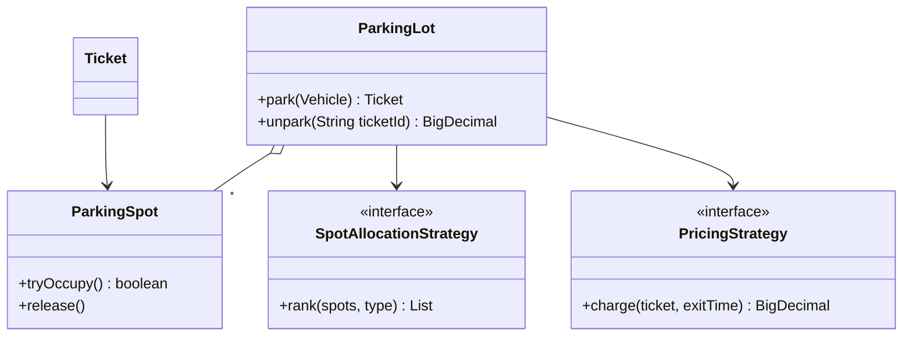

# OOAD, SOLID, Design Patterns & Low Level Design Interview Questions (10-Year Java Lead)

Code samples are Java 17+. They are interview-sized skeletons, not production code: add validation, logging, and error handling as you discuss them.

## Table of Contents

- [1. OOP and OOAD Fundamentals](#1-oop-and-ooad-fundamentals)
- [2. SOLID Principles (Questions)](#2-solid-principles-questions)
- [3. Other Design Principles](#3-other-design-principles)
- [4. Design Patterns (Questions)](#4-design-patterns-questions)
- [5. SOLID: Violation and Fix (Code)](#5-solid-violation-and-fix-code)
- [6. Design Pattern Implementations (Code)](#6-design-pattern-implementations-code)
- [7. Low Level Design: How to Approach](#7-low-level-design-how-to-approach)
- [8. LLD Problems (Requirements and Hints)](#8-lld-problems-requirements-and-hints)
- [9. LLD Worked Examples (Code)](#9-lld-worked-examples-code)
- [10. Refactoring and Design Scenario Questions](#10-refactoring-and-design-scenario-questions)
- [11. Rapid-Fire Questions](#11-rapid-fire-questions)

---

## 1. OOP and OOAD Fundamentals

1. Explain the four pillars of OOP with a real example for each. Which one do people misuse most?
2. Abstraction vs encapsulation: what is the difference, and how does Java enforce each?
3. Inheritance vs composition: why is "favour composition over inheritance" a rule, and when is inheritance still right?
4. Interface vs abstract class in modern Java (default methods, sealed types, records). How do you choose?
5. Overloading vs overriding: compile-time vs runtime dispatch. What are covariant return types and why can `static` or `private` methods not be overridden?
6. What is polymorphism really buying you in design (open for extension, replacing conditionals)?
7. Coupling and cohesion: how do you measure them and what do high cohesion and low coupling look like in code?
8. Explain association, aggregation, composition, dependency, generalisation, and realisation. Give a Java example of each and how it shows up in UML.
9. "Is-a" vs "has-a" vs "can-do" (interface). How do you avoid wrong inheritance hierarchies?
10. What is the difference between object-oriented analysis (OOA), design (OOD), and programming (OOP)? Walk through how you go from requirements to classes.
11. How do you identify classes and responsibilities from a requirements document (noun/verb analysis, CRC cards, use cases)?
12. What are value objects vs entities? Why make value objects immutable (`record`, defensive copies, `equals` / `hashCode`)?
13. Mutable vs immutable design: benefits for thread safety and caching. How do you build a properly immutable class?
14. Explain the `equals` / `hashCode` / `compareTo` contracts and what breaks in `HashMap` / `HashSet` when you violate them.
15. What is the Liskov-safe way to design a class meant for inheritance (final by default, template methods, documented hooks)? What is the fragile base class problem?
16. What are sealed classes and records, and how do they help model domain types (algebraic data types, exhaustive `switch`)?
17. How do generics help OO design (bounded types, wildcards, PECS)? Where do they hurt readability?
18. How does dependency injection relate to OOD? Constructor injection vs service locator.
19. What is an anemic domain model vs a rich domain model? Which one do Spring apps usually drift to, and why does it matter?
20. What is the difference between a class diagram, sequence diagram, state diagram, and activity diagram? Which do you draw in an LLD interview?
21. What are the common design smells (rigidity, fragility, immobility, viscosity, needless complexity, repetition, opacity)?
22. Explain the Law of Demeter and "Tell, Don't Ask" with a before/after example.

## 2. SOLID Principles (Questions)

### Single Responsibility Principle (SRP)

1. What does "a class should have one reason to change" mean in practice? How is it different from "does one thing"?
2. How do you spot an SRP violation in a Spring service class with 15 dependencies?
3. Can you over-apply SRP? What does class explosion look like, and how do you balance it?

### Open/Closed Principle (OCP)

4. How do you make code open for extension but closed for modification? Which patterns support it (Strategy, Decorator, Template Method, plugin / registry)?
5. Replace a growing `switch` / `if-else` over type with polymorphism. What do you do when new behaviour needs new data?
6. Is OCP ever worth breaking? When is a simple `switch` the better design?

### Liskov Substitution Principle (LSP)

7. State LSP precisely (preconditions, postconditions, invariants, history constraint). Why does `Square extends Rectangle` fail?
8. Give a real-world LSP violation in a Java codebase (`UnsupportedOperationException`, throwing subclasses, tightening preconditions). How do you fix the hierarchy?
9. How does LSP relate to design by contract and to the `Collections.unmodifiableList` problem?

### Interface Segregation Principle (ISP)

10. What is a "fat interface"? How do you split one without breaking existing clients?
11. How does ISP relate to SRP, role interfaces, and Spring Data repository design?

### Dependency Inversion Principle (DIP)

12. Dependency inversion vs dependency injection vs inversion of control: what are the differences?
13. Where should the interface live (in the high-level module, not the low-level one)? How does this show up in hexagonal / clean architecture?
14. How do you apply DIP when the dependency is a static utility, a clock, or a random generator (testability)?

### Applying SOLID

15. Review this design: a `ReportService` that reads from the DB, formats PDFs, and emails them. Which principles are violated and how would you refactor?
16. Which SOLID principle do you think matters most, and which one do teams apply too dogmatically?
17. How do SOLID principles map onto microservice design (service boundaries as SRP, contracts as ISP, gateways as DIP)?
18. How do you convince a team to refactor towards SOLID without a rewrite?

## 3. Other Design Principles

1. DRY, KISS, and YAGNI: when do they conflict? When is duplication cheaper than the wrong abstraction?
2. Composition over inheritance, programming to interfaces, and the Principle of Least Astonishment.
3. Separation of concerns and layering: why do layered architectures leak, and how do you prevent it?
4. GRASP patterns (Information Expert, Creator, Controller, Low Coupling, High Cohesion, Polymorphism, Pure Fabrication, Indirection, Protected Variations). Which three do you use daily?
5. Package design principles (REP, CCP, CRP, ADP, SDP, SAP): what is a cyclic dependency and how do you break it?
6. Hexagonal / ports-and-adapters and clean architecture: how do they apply DIP at system scale?
7. Domain-Driven Design tactical patterns (entity, value object, aggregate, repository, domain service, factory, domain event). How do aggregates set transaction boundaries?
8. Defensive programming vs design by contract: where do you validate (boundaries, constructors, invariants)?
9. Fail fast, exceptions design (checked vs unchecked, domain exceptions, error codes vs exceptions, avoiding exceptions for flow control).
10. Concurrency in design: immutability, confinement, thread-safe classes, lock granularity, and why you document thread-safety.

## 4. Design Patterns (Questions)

### General

1. What problem do design patterns solve, and what is the danger of pattern overuse ("golden hammer")?
2. Which patterns have you used in production, why, and what did they cost you?
3. Which patterns are effectively built into Java or Spring (iterator, observer, proxy, template, factory, singleton scope, builder, decorator)? Show where.
4. Which patterns become unnecessary with modern Java (lambdas, records, sealed types, streams, `Optional`)? Give examples (Strategy as a lambda, Visitor vs pattern matching, Builder vs records).

### Creational

5. Singleton: thread-safe implementations (eager, holder idiom, double-checked locking with `volatile`, enum). How can reflection, serialisation, and class loaders break it? Why is Spring's singleton scope different?
6. Why is Singleton often called an anti-pattern (hidden dependencies, global state, testing), and what do you do instead?
7. Factory Method vs Abstract Factory vs Simple Factory vs Spring `FactoryBean`. When do you use each?
8. Builder: when do you use it over constructors, records, or static factories? What are the telescoping constructor and invalid-state problems?
9. Prototype: when is cloning useful? Shallow vs deep copy, `Cloneable` pitfalls, copy constructors.
10. Object pool and flyweight: what do they share, and where does Java use them (`Integer` cache, string pool, connection pools)?
11. Dependency injection container as a "factory of factories": how does it replace `new` and static factories?

### Structural

12. Adapter vs Facade vs Proxy vs Decorator: how do they differ in intent when the structures look similar?
13. Proxy types (virtual, protection, remote, caching). How do JDK dynamic proxies and CGLIB work, and what do they cost?
14. Decorator: how does `java.io` use it? How do you avoid deep decorator chains that are hard to debug?
15. Composite: when does a tree of uniform components apply (file systems, menus, org charts, rule engines)?
16. Bridge vs Strategy vs Adapter: when do you decouple abstraction from implementation?
17. Flyweight: what is intrinsic vs extrinsic state, and when does it save memory?
18. Facade: how does it differ from an API gateway or a service layer?

### Behavioural

19. Strategy vs State vs Template Method: how do you tell them apart and when do they overlap?
20. Observer vs Pub/Sub vs event bus vs Reactive Streams: what coupling and threading issues appear (memory leaks from listeners, ordering, exceptions in listeners)?
21. Chain of Responsibility: where do servlet filters, Spring Security, and validation pipelines use it? How do you stop or short-circuit a chain?
22. Command: how do you implement undo/redo, queues, retries, and audit logs with commands?
23. Iterator and the `Iterable` contract: fail-fast vs fail-safe iterators, concurrent modification.
24. Mediator vs Observer: when do you centralise communication?
25. Visitor: what problem does it solve (double dispatch), and why is it awkward when the element hierarchy changes? How do sealed types and pattern matching change this?
26. Memento: how do you snapshot and restore object state without breaking encapsulation?
27. Interpreter and Specification patterns: when do you model business rules as composable objects?
28. Null Object: how does it remove null checks, and when is `Optional` better?
29. Template Method vs Strategy: inheritance-based vs composition-based variation. Why do many teams prefer Strategy?

### Enterprise and Architectural Patterns

30. Repository vs DAO. Unit of Work and Identity Map (how JPA's persistence context implements them).
31. Service Layer, DTO, Assembler / Mapper, and Specification patterns in a Spring app.
32. Circuit breaker, retry, bulkhead, and timeout as design patterns (not just libraries). How do you model them in code?
33. Saga, Outbox, CQRS, and Event Sourcing: which are object-level and which are system-level patterns?
34. Dependency injection, Service Locator, and Registry: why is Service Locator considered an anti-pattern?
35. Anti-patterns: God Object, Spaghetti Code, Anemic Domain Model, Singleton abuse, Golden Hammer, Premature Optimisation, Magic Numbers, Lava Flow, Shotgun Surgery, Feature Envy. How do you detect and fix each?

### Spring Mapping (Frequently Asked)

36. Name the pattern behind each: `BeanFactory`, `ApplicationContext` events, `@Transactional`, `JdbcTemplate`, `RestTemplate` callbacks, `HandlerInterceptor`, `DispatcherServlet`, `@Cacheable`, Spring Security filter chain, `HttpMessageConverter`, `@Profile`, `Environment`.
37. How would you implement a strategy registry using Spring (`Map<String, Strategy>` injection, `@Qualifier`, enums) so that new strategies need no changes to existing code?

## 5. SOLID: Violation and Fix (Code)

### SRP: One class doing everything

Violation:

```java
class Invoice {
    private final List<LineItem> items;

    Money calculateTotal() { /* business rule */ return null; }
    String printAsPdf()    { /* formatting */ return null; }
    void saveToDatabase()  { /* persistence */ }
    void emailToCustomer() { /* notification */ }
}
```

Fix:

```java
class Invoice {
    private final List<LineItem> items;
    Money total() { /* business rule only */ return null; }
}

interface InvoiceRenderer   { byte[] render(Invoice invoice); }
interface InvoiceRepository { void save(Invoice invoice); }
interface InvoiceNotifier   { void send(Invoice invoice, String to); }

class InvoiceService {
    private final InvoiceRepository repository;
    private final InvoiceRenderer renderer;
    private final InvoiceNotifier notifier;

    InvoiceService(InvoiceRepository r, InvoiceRenderer p, InvoiceNotifier n) {
        this.repository = r; this.renderer = p; this.notifier = n;
    }

    void issue(Invoice invoice, String customerEmail) {
        repository.save(invoice);
        renderer.render(invoice);
        notifier.send(invoice, customerEmail);
    }
}
```

### OCP: Type switch that grows forever

Violation:

```java
class DiscountCalculator {
    double discount(String customerType, double amount) {
        switch (customerType) {
            case "REGULAR": return amount * 0.05;
            case "PREMIUM": return amount * 0.10;
            case "VIP":     return amount * 0.20;   // every new type edits this class
            default:        return 0;
        }
    }
}
```

Fix with Strategy plus a registry (Spring injects every implementation):

```java
interface DiscountPolicy {
    String customerType();
    double apply(double amount);
}

@Component class RegularDiscount implements DiscountPolicy {
    public String customerType() { return "REGULAR"; }
    public double apply(double amount) { return amount * 0.05; }
}
@Component class PremiumDiscount implements DiscountPolicy {
    public String customerType() { return "PREMIUM"; }
    public double apply(double amount) { return amount * 0.10; }
}

@Service
class DiscountCalculator {
    private final Map<String, DiscountPolicy> policies;

    DiscountCalculator(List<DiscountPolicy> all) {
        this.policies = all.stream().collect(Collectors.toMap(DiscountPolicy::customerType, p -> p));
    }

    double discount(String type, double amount) {
        return policies.getOrDefault(type, a -> 0.0 ... ).apply(amount);   // see note
    }
}
// Note: use a NoDiscount default policy object (Null Object) instead of a lambda here.
// Adding "VIP" means adding one new class; DiscountCalculator never changes.
```

### LSP: Square is not a Rectangle

Violation:

```java
class Rectangle {
    protected int width, height;
    void setWidth(int w)  { this.width = w; }
    void setHeight(int h) { this.height = h; }
    int area() { return width * height; }
}

class Square extends Rectangle {
    @Override void setWidth(int w)  { this.width = w; this.height = w; }
    @Override void setHeight(int h) { this.width = h; this.height = h; }
}

// Client code that is correct for Rectangle breaks for Square:
void resize(Rectangle r) {
    r.setWidth(5); r.setHeight(4);
    assert r.area() == 20;      // fails for Square (area is 16)
}
```

Fix: do not model it as inheritance, or make the types immutable and share an abstraction:

```java
sealed interface Shape permits Rectangle, Square { int area(); }
record Rectangle(int width, int height) implements Shape { public int area() { return width * height; } }
record Square(int side) implements Shape { public int area() { return side * side; } }
```

Another LSP smell:

```java
interface Bird { void fly(); }
class Penguin implements Bird {
    public void fly() { throw new UnsupportedOperationException(); }   // violation
}
// Fix: Bird (eat, move), FlyingBird extends Bird (fly). Penguin is a Bird, not a FlyingBird.
```

### ISP: Fat interface

Violation:

```java
interface Worker { void work(); void eat(); void sleep(); }
class Robot implements Worker {
    public void work() {}
    public void eat()   { throw new UnsupportedOperationException(); }
    public void sleep() { throw new UnsupportedOperationException(); }
}
```

Fix:

```java
interface Workable { void work(); }
interface Feedable { void eat(); }
interface Restable { void sleep(); }

class Human implements Workable, Feedable, Restable { /* all three */ public void work(){} public void eat(){} public void sleep(){} }
class Robot implements Workable { public void work() {} }
```

### DIP: High-level class creating its own dependency

Violation:

```java
class OrderService {
    private final MySqlOrderRepository repository = new MySqlOrderRepository();   // hard dependency
    void place(Order o) { repository.save(o); }
}
```

Fix:

```java
interface OrderRepository { void save(Order o); }

class OrderService {
    private final OrderRepository repository;
    OrderService(OrderRepository repository) { this.repository = repository; }   // injected abstraction
    void place(Order o) { repository.save(o); }
}

// Production: new OrderService(new MySqlOrderRepository(...))
// Test:       new OrderService(new InMemoryOrderRepository())
// Also inject Clock and IdGenerator instead of calling Instant.now() / UUID.randomUUID() directly.
```

## 6. Design Pattern Implementations (Code)

### Singleton: three safe variants

```java
// 1. Enum (simplest, serialisation and reflection safe)
public enum AppRegistry { INSTANCE; public void register(String s) { /* ... */ } }

// 2. Initialization-on-demand holder (lazy, thread-safe, no locking)
public final class Config {
    private Config() {}
    private static final class Holder { static final Config INSTANCE = new Config(); }
    public static Config getInstance() { return Holder.INSTANCE; }
}

// 3. Double-checked locking (volatile is mandatory)
public final class Cache {
    private static volatile Cache instance;
    private Cache() {}
    public static Cache getInstance() {
        if (instance == null) {
            synchronized (Cache.class) {
                if (instance == null) instance = new Cache();
            }
        }
        return instance;
    }
}
```

### Factory Method and Simple Factory

```java
interface Notification { void send(String to, String message); }
class EmailNotification implements Notification { public void send(String to, String m) { /* ... */ } }
class SmsNotification   implements Notification { public void send(String to, String m) { /* ... */ } }
class PushNotification  implements Notification { public void send(String to, String m) { /* ... */ } }

enum Channel { EMAIL, SMS, PUSH }

class NotificationFactory {
    private static final Map<Channel, Supplier<Notification>> REGISTRY = Map.of(
        Channel.EMAIL, EmailNotification::new,
        Channel.SMS,   SmsNotification::new,
        Channel.PUSH,  PushNotification::new);

    static Notification create(Channel channel) {
        Supplier<Notification> s = REGISTRY.get(channel);
        if (s == null) throw new IllegalArgumentException("Unsupported channel " + channel);
        return s.get();
    }
}
```

### Builder (immutable object)

```java
public final class HttpRequestSpec {
    private final String url;
    private final String method;
    private final Map<String, String> headers;
    private final Duration timeout;

    private HttpRequestSpec(Builder b) {
        this.url = b.url; this.method = b.method;
        this.headers = Map.copyOf(b.headers); this.timeout = b.timeout;
    }

    public static Builder builder(String url) { return new Builder(url); }

    public static final class Builder {
        private final String url;
        private String method = "GET";
        private final Map<String, String> headers = new HashMap<>();
        private Duration timeout = Duration.ofSeconds(5);

        private Builder(String url) { this.url = Objects.requireNonNull(url); }
        public Builder method(String m)               { this.method = m; return this; }
        public Builder header(String k, String v)     { headers.put(k, v); return this; }
        public Builder timeout(Duration t)            { this.timeout = t; return this; }
        public HttpRequestSpec build() {
            if (timeout.isNegative()) throw new IllegalStateException("timeout must be >= 0");
            return new HttpRequestSpec(this);
        }
    }
}
```

### Strategy (payment) with lambdas

```java
interface PaymentStrategy { void pay(Money amount); }

class CardPayment implements PaymentStrategy {
    public void pay(Money amount) { /* call card gateway */ }
}
class UpiPayment implements PaymentStrategy {
    public void pay(Money amount) { /* call UPI */ }
}

class Checkout {
    private final PaymentStrategy strategy;
    Checkout(PaymentStrategy strategy) { this.strategy = strategy; }
    void complete(Money total) { strategy.pay(total); }
}

// A one-off strategy needs no class:
new Checkout(amount -> System.out.println("Wallet pay " + amount));
```

### Observer (type-safe event listeners)

```java
interface Listener<E> { void onEvent(E event); }

class EventPublisher<E> {
    private final List<Listener<E>> listeners = new CopyOnWriteArrayList<>();

    void subscribe(Listener<E> l)   { listeners.add(l); }
    void unsubscribe(Listener<E> l) { listeners.remove(l); }   // avoids leaks

    void publish(E event) {
        for (Listener<E> l : listeners) {
            try { l.onEvent(event); }
            catch (RuntimeException ex) { /* one bad listener must not break others: log it */ }
        }
    }
}
// Discuss: sync vs async delivery, ordering, back-pressure, and why Spring events are synchronous by default.
```

### Decorator (add behaviour without subclasses)

```java
interface DataSource { String read(); void write(String data); }

class FileDataSource implements DataSource {
    public String read() { return "raw"; }
    public void write(String data) { /* write to disk */ }
}

abstract class DataSourceDecorator implements DataSource {
    protected final DataSource wrapped;
    DataSourceDecorator(DataSource wrapped) { this.wrapped = wrapped; }
}

class EncryptionDecorator extends DataSourceDecorator {
    EncryptionDecorator(DataSource w) { super(w); }
    public String read()            { return decrypt(wrapped.read()); }
    public void write(String data)  { wrapped.write(encrypt(data)); }
    private String encrypt(String s) { return s; }   // placeholder
    private String decrypt(String s) { return s; }   // placeholder
}

class CompressionDecorator extends DataSourceDecorator { /* same shape */
    CompressionDecorator(DataSource w) { super(w); }
    public String read() { return wrapped.read(); }
    public void write(String data) { wrapped.write(data); }
}

DataSource ds = new CompressionDecorator(new EncryptionDecorator(new FileDataSource()));
```

### Chain of Responsibility (validation / approval)

```java
abstract class ApprovalHandler {
    private ApprovalHandler next;
    ApprovalHandler linkWith(ApprovalHandler next) { this.next = next; return next; }

    final boolean handle(ExpenseRequest r) {
        if (canApprove(r)) return true;
        return next != null && next.handle(r);
    }
    protected abstract boolean canApprove(ExpenseRequest r);
}

class TeamLead extends ApprovalHandler { protected boolean canApprove(ExpenseRequest r) { return r.amount() <= 1_000; } }
class Manager  extends ApprovalHandler { protected boolean canApprove(ExpenseRequest r) { return r.amount() <= 10_000; } }
class Director extends ApprovalHandler { protected boolean canApprove(ExpenseRequest r) { return r.amount() <= 100_000; } }

record ExpenseRequest(String id, long amount) {}

// Wiring
ApprovalHandler chain = new TeamLead();
chain.linkWith(new Manager()).linkWith(new Director());
```

### State (order lifecycle)

```java
interface OrderState {
    OrderState pay();
    OrderState ship();
    OrderState cancel();
}

enum OrderStates implements OrderState {
    NEW {
        public OrderState pay()    { return PAID; }
        public OrderState ship()   { throw new IllegalStateException("Pay first"); }
        public OrderState cancel() { return CANCELLED; }
    },
    PAID {
        public OrderState pay()    { throw new IllegalStateException("Already paid"); }
        public OrderState ship()   { return SHIPPED; }
        public OrderState cancel() { return CANCELLED; }   // trigger refund elsewhere
    },
    SHIPPED {
        public OrderState pay()    { throw new IllegalStateException(); }
        public OrderState ship()   { throw new IllegalStateException(); }
        public OrderState cancel() { throw new IllegalStateException("Already shipped"); }
    },
    CANCELLED {
        public OrderState pay()    { throw new IllegalStateException(); }
        public OrderState ship()   { throw new IllegalStateException(); }
        public OrderState cancel() { return this; }
    }
}

class Order {
    private OrderState state = OrderStates.NEW;
    void pay()    { state = state.pay(); }
    void ship()   { state = state.ship(); }
    void cancel() { state = state.cancel(); }
}
// Replaces a big switch(status) in every method. Discuss persistence of state and concurrent transitions.
```

### Template Method

```java
abstract class DataImporter {
    public final void importData(Path file) {      // the skeleton is final
        List<String> lines = read(file);
        List<Record> records = parse(lines);
        validate(records);
        save(records);
    }
    protected abstract List<Record> parse(List<String> lines);
    protected void validate(List<Record> records) { /* default: no-op, hook */ }
    private List<String> read(Path file) { /* common */ return List.of(); }
    private void save(List<Record> records) { /* common */ }
}
class CsvImporter  extends DataImporter { protected List<Record> parse(List<String> l) { return List.of(); } }
class JsonImporter extends DataImporter { protected List<Record> parse(List<String> l) { return List.of(); } }
```

### Proxy (JDK dynamic proxy for logging / timing)

```java
interface PaymentService { void pay(String orderId, long amount); }

class TimingHandler implements InvocationHandler {
    private final Object target;
    TimingHandler(Object target) { this.target = target; }

    @Override
    public Object invoke(Object proxy, Method method, Object[] args) throws Throwable {
        long start = System.nanoTime();
        try {
            return method.invoke(target, args);
        } catch (InvocationTargetException e) {
            throw e.getCause();
        } finally {
            System.out.println(method.getName() + " took " + (System.nanoTime() - start) + " ns");
        }
    }
}

PaymentService real = (id, amt) -> { /* ... */ };
PaymentService proxied = (PaymentService) Proxy.newProxyInstance(
        PaymentService.class.getClassLoader(),
        new Class<?>[] { PaymentService.class },
        new TimingHandler(real));
// This is how Spring AOP creates proxies for interface-based beans (CGLIB for classes).
```

### Command with undo

```java
interface Command { void execute(); void undo(); }

class AddTextCommand implements Command {
    private final StringBuilder doc; private final String text;
    AddTextCommand(StringBuilder doc, String text) { this.doc = doc; this.text = text; }
    public void execute() { doc.append(text); }
    public void undo()    { doc.setLength(doc.length() - text.length()); }
}

class Editor {
    private final Deque<Command> history = new ArrayDeque<>();
    void run(Command c) { c.execute(); history.push(c); }
    void undo()         { if (!history.isEmpty()) history.pop().undo(); }
}
```

### Specification (composable business rules)

```java
interface Spec<T> {
    boolean isSatisfiedBy(T t);
    default Spec<T> and(Spec<T> other) { return t -> isSatisfiedBy(t) && other.isSatisfiedBy(t); }
    default Spec<T> or(Spec<T> other)  { return t -> isSatisfiedBy(t) || other.isSatisfiedBy(t); }
    default Spec<T> not()              { return t -> !isSatisfiedBy(t); }
}

Spec<Customer> adult     = c -> c.age() >= 18;
Spec<Customer> verified  = Customer::kycVerified;
Spec<Customer> eligible  = adult.and(verified);
```

## 7. Low Level Design: How to Approach

Use this framework out loud in the interview (about 35 to 45 minutes):

1. **Clarify requirements (5 min).** Functional scope, actors, what is out of scope, scale hints, concurrency expectations. Write down 4 to 6 requirements and confirm them.
2. **Identify entities and relationships (5 min).** Nouns become classes or enums, verbs become methods. Decide has-a vs is-a. Note which objects are value objects.
3. **Define APIs first (5 min).** The public interface of the main service (`park`, `unpark`, `bookSeat`, `allow(key)`). Decide input/output types and error handling.
4. **Draw the class diagram (5 to 10 min).** Show interfaces, key relationships, and where extension points sit.
5. **Choose patterns only where they pay off.** Name the variation point first (pricing, allocation, notification channel), then the pattern (Strategy, Factory, Observer, State).
6. **Write core code (10 to 15 min).** The main flow, one or two strategies, and the main data structures. Keep it compile-ready.
7. **Cover concurrency, edge cases, and testing.** Race conditions, locking granularity, idempotency, invalid transitions, time and clock injection.
8. **Discuss extensibility.** "How would you add X?" Show that existing classes stay unchanged (OCP).
9. **Say what you would do next.** Persistence, caching, distribution, metrics, and how the in-memory design maps to a service.

Things interviewers listen for:

- You asked questions before drawing.
- Classes have single responsibilities and clear names.
- Variation is behind interfaces; the core flow does not contain `if (type == ...)` chains.
- You considered thread safety and failure cases without being prompted.
- You can explain trade-offs and say what you chose not to build.

## 8. LLD Problems (Requirements and Hints)

For each: entities, patterns, concurrency and edge cases, and extension questions to practise.

### 1. Parking Lot
- **Entities:** ParkingLot, Level, ParkingSpot, Vehicle, Ticket, Payment, EntryGate / ExitGate.
- **Patterns:** Strategy (spot allocation, pricing), Factory (vehicle/spot creation), Singleton-like facade (or injected service).
- **Hard parts:** two cars taking the same spot (atomic occupy), lost ticket, reserved or EV spots, multi-floor search cost.
- **Extensions:** hourly vs flat vs dynamic pricing, valet, reservations, display boards (Observer).

### 2. Elevator System
- **Entities:** ElevatorController, Elevator, Request (internal / external), Direction, Door, Floor.
- **Patterns:** State (idle, moving up, moving down, maintenance), Strategy (scheduling: SCAN / nearest car), Observer (floor displays).
- **Hard parts:** request assignment with multiple elevators, direction changes, overweight, emergency stop.
- **Extensions:** peak-hour policies, express elevators, maintenance mode.

### 3. LRU / LFU Cache
- **Entities:** Cache, Node, EvictionPolicy.
- **Patterns:** Strategy (eviction policy), Decorator (stats or TTL on top).
- **Hard parts:** O(1) get/put, thread safety, TTL expiry, memory bounds.
- **Extensions:** LFU, write-through vs write-back, distributed cache consistency.

### 4. Rate Limiter
- **Entities:** RateLimiter interface, TokenBucket, SlidingWindow, FixedWindow, LimiterRegistry (per user/API key).
- **Patterns:** Strategy (algorithm), Factory (create by rule), Chain of Responsibility (multiple rules).
- **Hard parts:** atomic refill and consume, per-key memory cleanup, clock source, distributed counters (Redis, Lua).

### 5. Vending Machine / ATM
- **Entities:** Machine, Inventory / CashDispenser, Product, Coin/Note, Transaction.
- **Patterns:** State (idle, has money, dispensing, out of service), Chain of Responsibility (cash denominations), Command.
- **Hard parts:** change-making, partial failures (dispense fails after payment), refunds, audit.

### 6. Library / Hotel / Movie Ticket Booking (BookMyShow)
- **Entities:** Show, Screen, Seat, Booking, Payment, User, Theatre.
- **Patterns:** State (booking lifecycle), Strategy (pricing), Observer (notifications), Facade (booking service).
- **Hard parts:** double booking (seat locking with expiry), payment timeout releasing seats, idempotent confirm, concurrent holds.

### 7. Splitwise / Expense Sharing
- **Entities:** User, Group, Expense, Split (Equal / Exact / Percentage), Balance, Settlement.
- **Patterns:** Strategy (split types), Factory (split creation), Observer (notifications).
- **Hard parts:** rounding, simplifying debts (graph of net balances), consistency under concurrent updates, `BigDecimal` money handling.

### 8. Logger Framework
- **Entities:** Logger, LogLevel, Appender (console, file, network), Formatter, LogRecord.
- **Patterns:** Singleton / registry (logger per name), Chain of Responsibility (level filters), Strategy (formatter), Observer (appenders), Decorator.
- **Hard parts:** async logging with bounded queue, back-pressure, thread safety, rolling files.

### 9. Notification System
- **Entities:** Notification, Channel (email / SMS / push), Template, UserPreference, Dispatcher, RetryPolicy.
- **Patterns:** Strategy / Factory (channel), Observer, Template Method, Chain (priority and rate-limit rules), Decorator (retry, logging).
- **Hard parts:** retries with back-off, de-duplication, opt-outs, rate limits per channel, ordering.

### 10. Pub/Sub or In-Memory Message Queue
- **Entities:** Broker, Topic, Publisher, Subscriber, Message, Offset.
- **Patterns:** Observer, Strategy (delivery policy), Command.
- **Hard parts:** per-subscriber offsets, slow consumers, ordering per partition, thread-safe subscription, at-least-once handling.

### 11. Task Scheduler / Job Scheduler
- **Entities:** Task, Scheduler, Trigger (once, fixed-rate, cron), Executor, JobStore.
- **Patterns:** Command, Strategy (trigger), Observer (listeners), Builder.
- **Hard parts:** delay queue vs polling, task failures and retries, cancellation, clock changes, single execution in a cluster.

### 12. Cab Booking (Uber-like)
- **Entities:** Rider, Driver, Trip, Location, Vehicle, Fare, Payment.
- **Patterns:** Strategy (driver matching, pricing, surge), State (trip lifecycle), Observer (location updates).
- **Hard parts:** concurrent assignment of one driver to two trips, timeout and re-matching, geo lookup structure.

### 13. Chess / Tic-Tac-Toe / Snake and Ladder
- **Entities:** Game, Board, Player, Piece, Move, Dice.
- **Patterns:** Strategy (piece movement, dice), State (game status), Command (undo), Factory (pieces).
- **Hard parts:** move validation, check/checkmate detection, undo, game replay.

### 14. URL Shortener (LLD view)
- **Entities:** UrlMapping, KeyGenerator, Repository, Analytics.
- **Patterns:** Strategy (key generation: counter + base62, hash, random), Repository, Decorator (cache).
- **Hard parts:** collision handling, idempotent creation, expiry, concurrency in counter allocation.

### 15. In-Memory File System / Key-Value Store
- **Entities:** Directory, File, Path, Node (Composite), Store, Transaction.
- **Patterns:** Composite, Command (operations log), Memento (snapshots), Visitor (size/search).
- **Hard parts:** path parsing, permissions, concurrent edits, transactions and rollback.

### 16. Food Delivery / Inventory / Warehouse
- **Entities:** Restaurant, Menu, Order, Cart, DeliveryAgent, Inventory, Payment.
- **Patterns:** State, Strategy (assignment, pricing), Observer, Saga-like orchestration at the service layer.
- **Hard parts:** stock reservation, partial fulfilment, cancellation, idempotency.

## 9. LLD Worked Examples (Code)

### Parking Lot (core skeleton)



```java
public enum VehicleType { BIKE, CAR, TRUCK }

public record Vehicle(String number, VehicleType type) {}

public class ParkingSpot {
    private final String id;
    private final VehicleType supportedType;
    private final AtomicBoolean occupied = new AtomicBoolean(false);

    public ParkingSpot(String id, VehicleType supportedType) { this.id = id; this.supportedType = supportedType; }

    public boolean supports(VehicleType type) { return supportedType == type; }
    public boolean isFree()      { return !occupied.get(); }
    public boolean tryOccupy()   { return occupied.compareAndSet(false, true); }   // atomic, no double booking
    public void release()        { occupied.set(false); }
    public String id()           { return id; }
}

public record Ticket(String id, Vehicle vehicle, ParkingSpot spot, Instant entryTime) {}

public interface SpotAllocationStrategy {
    /** Returns candidate spots in preference order; the lot tries to occupy them atomically. */
    List<ParkingSpot> rank(List<ParkingSpot> spots, VehicleType type);
}

public class NearestFirstStrategy implements SpotAllocationStrategy {
    @Override
    public List<ParkingSpot> rank(List<ParkingSpot> spots, VehicleType type) {
        return spots.stream().filter(s -> s.supports(type) && s.isFree()).toList();   // list order = distance order
    }
}

public interface PricingStrategy {
    BigDecimal charge(Ticket ticket, Instant exitTime);
}

public class HourlyPricing implements PricingStrategy {
    private final Map<VehicleType, BigDecimal> ratePerHour;
    public HourlyPricing(Map<VehicleType, BigDecimal> ratePerHour) { this.ratePerHour = Map.copyOf(ratePerHour); }

    @Override
    public BigDecimal charge(Ticket t, Instant exit) {
        long minutes = Duration.between(t.entryTime(), exit).toMinutes();
        long hours = Math.max(1, (minutes + 59) / 60);                 // round up, minimum one hour
        return ratePerHour.get(t.vehicle().type()).multiply(BigDecimal.valueOf(hours));
    }
}

public class NoSpotAvailableException extends RuntimeException {
    public NoSpotAvailableException(VehicleType type) { super("No free spot for " + type); }
}

public class ParkingLot {
    private final List<ParkingSpot> spots;
    private final SpotAllocationStrategy allocation;
    private final PricingStrategy pricing;
    private final Clock clock;                                          // injected for tests
    private final Map<String, Ticket> activeTickets = new ConcurrentHashMap<>();

    public ParkingLot(List<ParkingSpot> spots, SpotAllocationStrategy allocation,
                      PricingStrategy pricing, Clock clock) {
        this.spots = List.copyOf(spots); this.allocation = allocation; this.pricing = pricing; this.clock = clock;
    }

    public Ticket park(Vehicle vehicle) {
        for (ParkingSpot spot : allocation.rank(spots, vehicle.type())) {
            if (spot.tryOccupy()) {                                     // loser of a race moves to the next candidate
                Ticket ticket = new Ticket(UUID.randomUUID().toString(), vehicle, spot, clock.instant());
                activeTickets.put(ticket.id(), ticket);
                return ticket;
            }
        }
        throw new NoSpotAvailableException(vehicle.type());
    }

    public BigDecimal unpark(String ticketId) {
        Ticket ticket = activeTickets.remove(ticketId);                 // atomic: second call gets null
        if (ticket == null) throw new IllegalArgumentException("Unknown or already used ticket");
        BigDecimal fee = pricing.charge(ticket, clock.instant());
        ticket.spot().release();
        return fee;
    }
}
// Discuss: payment failure after unpark (release spot only after successful payment?), lost tickets,
// per-floor indexing for faster search, EV / reserved spots (new spot types), display boards via Observer.
```

### LRU Cache (O(1), thread-safe)

```java
// Quick version: good for interviews if you also explain why it works
public class SimpleLru<K, V> extends LinkedHashMap<K, V> {
    private final int capacity;
    public SimpleLru(int capacity) { super(capacity, 0.75f, true); this.capacity = capacity; }   // access-order
    @Override protected boolean removeEldestEntry(Map.Entry<K, V> eldest) { return size() > capacity; }
}
// Not thread-safe. Wrapping in synchronizedMap is correct but coarse because get() mutates order.

// Manual version: hash map + doubly linked list
public class LruCache<K, V> {
    private static final class Node<K, V> {
        final K key; V value; Node<K, V> prev, next;
        Node(K key, V value) { this.key = key; this.value = value; }
    }

    private final int capacity;
    private final Map<K, Node<K, V>> map = new HashMap<>();
    private final Node<K, V> head = new Node<>(null, null);    // most recently used side
    private final Node<K, V> tail = new Node<>(null, null);    // least recently used side
    private final ReentrantLock lock = new ReentrantLock();

    public LruCache(int capacity) {
        if (capacity <= 0) throw new IllegalArgumentException("capacity must be positive");
        this.capacity = capacity;
        head.next = tail; tail.prev = head;
    }

    public V get(K key) {
        lock.lock();
        try {
            Node<K, V> n = map.get(key);
            if (n == null) return null;
            unlink(n); addFirst(n);
            return n.value;
        } finally { lock.unlock(); }
    }

    public void put(K key, V value) {
        lock.lock();
        try {
            Node<K, V> n = map.get(key);
            if (n != null) { n.value = value; unlink(n); addFirst(n); return; }
            if (map.size() == capacity) {
                Node<K, V> lru = tail.prev;
                unlink(lru); map.remove(lru.key);
            }
            n = new Node<>(key, value);
            map.put(key, n); addFirst(n);
        } finally { lock.unlock(); }
    }

    private void unlink(Node<K, V> n)   { n.prev.next = n.next; n.next.prev = n.prev; }
    private void addFirst(Node<K, V> n) { n.next = head.next; n.prev = head; head.next.prev = n; head.next = n; }
}
// Discuss: striped locks / Caffeine for production, TTL, EvictionPolicy interface for LFU, metrics, null values.
```

### Token Bucket Rate Limiter (Strategy-ready)

```java
public interface RateLimiter { boolean tryAcquire(); }

public class TokenBucketLimiter implements RateLimiter {
    private final long capacity;
    private final double refillPerNano;
    private final LongSupplier nanoClock;       // injected for deterministic tests
    private double tokens;
    private long lastRefill;

    public TokenBucketLimiter(long capacity, double refillPerSecond, LongSupplier nanoClock) {
        this.capacity = capacity;
        this.refillPerNano = refillPerSecond / 1_000_000_000.0;
        this.nanoClock = nanoClock;
        this.tokens = capacity;
        this.lastRefill = nanoClock.getAsLong();
    }

    @Override
    public synchronized boolean tryAcquire() {
        long now = nanoClock.getAsLong();
        tokens = Math.min(capacity, tokens + (now - lastRefill) * refillPerNano);
        lastRefill = now;
        if (tokens >= 1) { tokens -= 1; return true; }
        return false;
    }
}

public class KeyedRateLimiter {
    private final ConcurrentMap<String, RateLimiter> limiters = new ConcurrentHashMap<>();
    private final Supplier<RateLimiter> factory;
    public KeyedRateLimiter(Supplier<RateLimiter> factory) { this.factory = factory; }

    public boolean allow(String key) { return limiters.computeIfAbsent(key, k -> factory.get()).tryAcquire(); }
}

// Usage
KeyedRateLimiter api = new KeyedRateLimiter(() -> new TokenBucketLimiter(10, 5, System::nanoTime));
boolean ok = api.allow("user-42");
// Discuss: sliding window log vs counter vs token bucket trade-offs, memory eviction for idle keys,
// distributed version (Redis + Lua script for atomic refill-and-consume), returning retry-after.
```

### Pub/Sub (in-memory, per-subscriber delivery)

```java
public interface Subscriber<T> { void onMessage(T message); }

public class Topic<T> {
    private final String name;
    private final List<Subscriber<T>> subscribers = new CopyOnWriteArrayList<>();
    private final ExecutorService executor;

    public Topic(String name, ExecutorService executor) { this.name = name; this.executor = executor; }

    public void subscribe(Subscriber<T> s)   { subscribers.add(s); }
    public void unsubscribe(Subscriber<T> s) { subscribers.remove(s); }

    public void publish(T message) {
        for (Subscriber<T> s : subscribers) {
            executor.submit(() -> {
                try { s.onMessage(message); }
                catch (RuntimeException e) { /* log, optionally retry or send to a dead-letter store */ }
            });
        }
    }
}

public class Broker {
    private final ConcurrentMap<String, Topic<String>> topics = new ConcurrentHashMap<>();
    private final ExecutorService executor = Executors.newFixedThreadPool(8);

    public Topic<String> topic(String name) { return topics.computeIfAbsent(name, n -> new Topic<>(n, executor)); }
}
// Discuss: this loses ordering per subscriber (use a per-subscriber single-thread queue or offsets),
// has no persistence or replay, and no back-pressure. Evolve it into per-subscriber queues with offsets.
```

## 10. Refactoring and Design Scenario Questions

1. A 2,000-line `OrderService` has twenty `if (type == ...)` blocks and ten dependencies. How do you refactor it safely without a rewrite (characterisation tests, extract class, strategy, strangler)?
2. A new payment provider must be added every month and each change touches core checkout code. How do you redesign it?
3. A subclass overrides a method and throws `UnsupportedOperationException`. What does that tell you and how do you fix the hierarchy?
4. A class has 12 constructor parameters, half optional. What are your options (Builder, parameter object, splitting the class, records with defaults via factory methods)?
5. Your singleton holds mutable state and causes flaky tests. How do you restructure it?
6. A utility class with static methods calls the database and the clock. How do you make it testable?
7. A `Notification` hierarchy has `EmailNotification`, `UrgentEmailNotification`, `SmsUrgentNotification` and keeps multiplying. How do you model priority and channel independently (Bridge, composition)?
8. Two modules depend on each other (cyclic dependency). How do you break the cycle?
9. A team uses inheritance to share utility code (`BaseService` with 30 helper methods). What is wrong with that, and what do you replace it with?
10. How do you design a plugin system where third parties add behaviour without modifying your core (SPI, `ServiceLoader`, Spring `Map` injection, registration API)?
11. How do you design a rules engine for discounts or eligibility so business can add rules without redeploying (Specification, Strategy, Chain, expression language)?
12. A domain model has public setters and all logic in services. How do you move behaviour into the entities and protect invariants?
13. You must support undo, audit, and replay of user actions. How do Command, Memento, and Event Sourcing differ for that?
14. Design a workflow (approval chain) that changes by customer. How do you model it so that it is configurable but still testable?
15. A hierarchy has a `Visitor` with 40 `visit` methods that change every sprint. What alternatives do you consider (sealed types with pattern matching, polymorphism, strategy)?
16. How do you design a type-safe configuration object that is immutable, validated, and easily extended?
17. A thread-safe class uses `synchronized` on every method and became a bottleneck. How do you redesign for concurrency (immutability, finer locks, concurrent collections, copy-on-write)?
18. How do you decide between inheritance, interface default methods, and composition for sharing code across seven similar classes?

## 11. Rapid-Fire Questions

1. What are the four pillars of OOP?
2. Abstract class vs interface: when do you choose each?
3. What is the difference between composition and aggregation?
4. State the five SOLID principles in one line each.
5. What breaks if `equals` is overridden without `hashCode`?
6. What is the difference between overloading and overriding?
7. Is a Spring bean singleton the same as the Singleton pattern?
8. Name three creational, three structural, and three behavioural patterns.
9. Factory Method vs Abstract Factory in one sentence each.
10. Strategy vs State: what is the key difference?
11. Adapter vs Facade vs Proxy: one line each.
12. Decorator vs inheritance: why prefer decorator?
13. How does Spring AOP use the Proxy pattern?
14. What is the difference between Observer and Pub/Sub?
15. How do you make a class immutable in Java?
16. What is a God Object and how do you fix it?
17. What is the Law of Demeter?
18. What is dependency injection and what are its three forms?
19. What is the difference between DIP, DI, and IoC?
20. Why is double-checked locking broken without `volatile`?
21. How does an enum singleton resist reflection and serialisation attacks?
22. What does "program to an interface" mean in practice?
23. When would you use a Null Object?
24. What is the difference between Template Method and Strategy?
25. What is the Interface Segregation violation in a repository that has 40 methods?
26. What is a value object? Name three examples in your last project.
27. Which pattern would you use to add logging and metrics to many services without changing them?
28. Which pattern implements undo/redo?
29. Which pattern fits "different algorithms chosen at runtime"?
30. How do you test a class that creates its own dependencies with `new`?