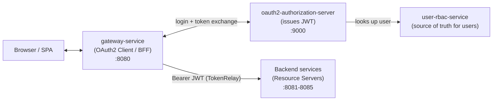
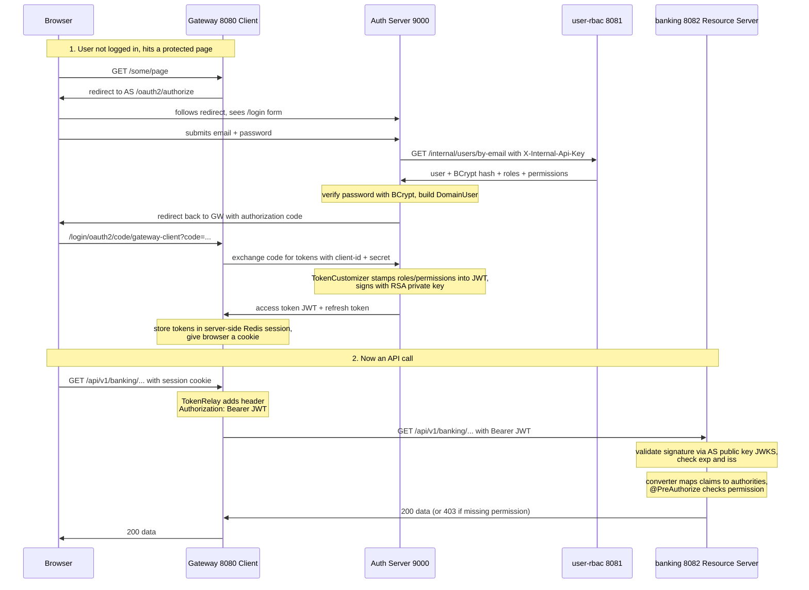

# OAuth2 & Spring Security — Concepts by Code

> A fresh, learner-first walkthrough of **how security actually works in this project**.
> We learn each concept, then immediately look at *our* code that implements it.
> Read top to bottom the first time — every section builds on the previous one.

---

## Part 0 — The mental model (read this first)

Forget frameworks for a second. Security here answers three questions:

1. **Who are you?** → *Authentication* (prove your identity, get a token)
2. **What are you allowed to do?** → *Authorization* (your token carries roles/permissions)
3. **How do services trust each other without asking you again?** → *Stateless JWT validation*

In this project those three jobs are split across **three kinds of applications**:

| Role | Who plays it | Job |
| :--- | :--- | :--- |
| **Authorization Server** | `oauth2-authorization-server` (port 9000) | The *only* app that logs users in and **mints tokens** |
| **Client / BFF** | `gateway-service` (port 8080) | Starts the login dance, holds the token, forwards it |
| **Resource Server** | the 5 backend services (8081–8085) | Trusts tokens, enforces permissions, serves data |

A single sentence to memorize:

> **One app issues tokens, one app collects the token for the browser, and every other app only *verifies* tokens.**



---

## Part 1 — What is a JWT and why it matters here

A **JWT (JSON Web Token)** is a string with three dot-separated parts:

```
header . payload . signature
```

- **header** — algorithm used (here: `RS256`, RSA signature)
- **payload** — the *claims* (who you are, what you can do, when it expires)
- **signature** — a cryptographic seal created with a **private key**

The magic: anyone holding the matching **public key** can verify the signature is authentic, *without calling the issuer*. That is what makes microservices scale — a backend validates a token **offline**.

In our system the payload (claims) is shaped by us — see the token customizer in Part 3. It contains:

```jsonc
{
  "sub": "the-user-id",
  "email": "alice@example.com",
  "fullName": "Alice",
  "roles": ["ADMIN"],
  "permissions": ["account:read", "transfer:execute"],
  "exp": 1730000000      // expiry — 15 minutes from issue
}
```

Keep this payload in your head. Everything downstream reads `roles` and `permissions` from it.

---

## Part 2 — The Authorization Server: the token factory

File: [micro-service/oauth2-authorization-server/src/main/java/com/learning/oauth2/infrastructure/config/AuthorizationServerConfig.java](micro-service/oauth2-authorization-server/src/main/java/com/learning/oauth2/infrastructure/config/AuthorizationServerConfig.java)

This is the heart of the system. Let's read it piece by piece.

### 2.1 — Two filter chains, and *order matters*

Spring Security processes requests through a **filter chain**. Here we deliberately register **two**, with `@Order`:

```java
@Bean
@Order(1)   // highest priority — checked first
public SecurityFilterChain authorizationServerSecurityFilterChain(HttpSecurity http) throws Exception {
    OAuth2AuthorizationServerConfiguration.applyDefaultSecurity(http); // wires /oauth2/token, /oauth2/authorize, JWKS, etc.
    http.getConfigurer(OAuth2AuthorizationServerConfigurer.class)
            .oidc(Customizer.withDefaults()); // enables OpenID Connect (/.well-known, userinfo)

    http.exceptionHandling(exceptions -> exceptions
            .defaultAuthenticationEntryPointFor(
                    new LoginUrlAuthenticationEntryPoint("/login"), // browser hitting a protected OAuth2 page → redirect to login form
                    new MediaTypeRequestMatcher(MediaType.TEXT_HTML)
            )
    );
    http.oauth2ResourceServer(resourceServer -> resourceServer.jwt(Customizer.withDefaults()));
    return http.build();
}

@Bean
@Order(2)   // fallback for everything the first chain didn't claim
public SecurityFilterChain defaultSecurityFilterChain(HttpSecurity http) throws Exception {
    http
            .authorizeHttpRequests(authorize -> authorize
                    .requestMatchers("/actuator/**", "/login", "/error", "/css/**").permitAll()
                    .anyRequest().authenticated()
            )
            .formLogin(form -> form.loginPage("/login").permitAll()); // our custom login page
    return http.build();
}
```

**Learner insight — why two chains?**
- Chain **#1** only matches OAuth2 protocol endpoints (`/oauth2/authorize`, `/oauth2/token`, `/.well-known/...`). These must behave in a very specific, spec-compliant way.
- Chain **#2** protects *everything else* (our login page, static CSS). It says: show a form login.

`@Order(1)` is tried first; if its matcher doesn't apply, Spring falls through to `@Order(2)`. This separation is the **recommended pattern** for an Authorization Server.

### 2.2 — Registering a client (who is allowed to ask for tokens)

A **client** is an *application*, not a user. Only registered clients may request tokens. Here we register exactly one — the gateway.

```java
@Bean
public RegisteredClientRepository registeredClientRepository(
        OAuth2ServerProperties properties, PasswordEncoder passwordEncoder) {

    OAuth2ServerProperties.GatewayClient gateway = properties.gatewayClient();

    RegisteredClient gatewayClient = RegisteredClient.withId(UUID.randomUUID().toString())
            .clientId(gateway.clientId())                               // "gateway-client"
            .clientSecret(passwordEncoder.encode(gateway.clientSecret())) // BCrypt-hashed secret
            .clientAuthenticationMethod(ClientAuthenticationMethod.CLIENT_SECRET_BASIC)
            .clientAuthenticationMethod(ClientAuthenticationMethod.CLIENT_SECRET_POST)
            .authorizationGrantType(AuthorizationGrantType.AUTHORIZATION_CODE) // the login flow
            .authorizationGrantType(AuthorizationGrantType.REFRESH_TOKEN)      // silent renewal
            .redirectUri(gateway.redirectUri())  // where the AS sends the user back after login
            .scope(OidcScopes.OPENID)            // "I want an ID token / identity"
            .scope(OidcScopes.PROFILE)
            .scope("api.read")                   // custom scope for our APIs
            .clientSettings(ClientSettings.builder()
                    .requireAuthorizationConsent(false) // skip the "do you allow this app?" screen
                    .requireProofKey(false)             // PKCE off (safe here: confidential server-side client)
                    .build())
            .tokenSettings(TokenSettings.builder()
                    .accessTokenTimeToLive(Duration.ofMinutes(15))  // short-lived access token
                    .refreshTokenTimeToLive(Duration.ofHours(8))    // longer-lived refresh token
                    .reuseRefreshTokens(true)
                    .build())
            .build();

    return new InMemoryRegisteredClientRepository(gatewayClient);
}
```

**Concepts unlocked here:**
- **Grant type** = *the recipe for getting a token*. `AUTHORIZATION_CODE` is the browser redirect login. `REFRESH_TOKEN` lets the gateway get a new access token without re-logging-in the user.
- **Scope** = a coarse label of what the client is asking for (`openid`, `profile`, `api.read`). Different from *permissions* (fine-grained, per-user).
- **Client secret is BCrypt-hashed** before storage — the client proves itself with the raw secret, we only keep the hash.
- **Token lifetimes**: access token lives **15 min** (small blast radius if stolen); refresh token **8 h**.
- `InMemoryRegisteredClientRepository` → fine for learning; a production system would use a JDBC-backed repository.

### 2.3 — The signing keys (JWKS)

Tokens must be *signed*. We generate an RSA key pair at startup and expose the **public** half so resource servers can verify.

```java
@Bean
public JWKSource<SecurityContext> jwkSource() {
    KeyPair keyPair = generateRsaKey();                 // 2048-bit RSA, created in-memory on boot
    RSAPublicKey publicKey  = (RSAPublicKey) keyPair.getPublic();
    RSAPrivateKey privateKey = (RSAPrivateKey) keyPair.getPrivate();
    RSAKey rsaKey = new RSAKey.Builder(publicKey)
            .privateKey(privateKey)
            .keyID(UUID.randomUUID().toString())        // "kid" — lets us rotate keys later
            .build();
    return new ImmutableJWKSet<>(new JWKSet(rsaKey));
}
```

- The **private key signs** every token (stays inside the AS, never leaves).
- The **public key** is published at `http://localhost:9000/oauth2/jwks` so anyone can *verify*.
- `keyID` (`kid`) is written into each token header → a resource server knows which public key to use.

> ⚠️ **Learner caveat:** the key is generated *fresh on every restart* (in-memory). That means restarting the AS invalidates all live tokens. Great for a demo, but production would load a **persistent** key from a keystore/secret.

### 2.4 — The issuer identity

```java
@Bean
public AuthorizationServerSettings authorizationServerSettings(OAuth2ServerProperties properties) {
    return AuthorizationServerSettings.builder()
            .issuer(properties.issuerUri())   // http://localhost:9000
            .build();
}
```

The **issuer URI** is the server's name tag. It is stamped into every token's `iss` claim, and it is the address resource servers use to discover the public keys. In config:

```yaml
# oauth2-authorization-server/src/main/resources/application.yml
server:
  port: 9000
app:
  issuer-uri: ${OAUTH2_ISSUER_URI:http://localhost:9000}
```

---

## Part 3 — Who is the user? (Authentication source of truth)

The Authorization Server does **not** store users. It asks the `user-rbac-service` over HTTP. This keeps a single source of truth for identity.

### 3.1 — Loading a user: `UserDetailsService`

Spring Security's contract for "fetch a user by username" is the `UserDetailsService` interface. Ours delegates to a REST call:

File: [micro-service/oauth2-authorization-server/src/main/java/com/learning/oauth2/infrastructure/security/DomainUserDetailsService.java](micro-service/oauth2-authorization-server/src/main/java/com/learning/oauth2/infrastructure/security/DomainUserDetailsService.java)

```java
@Service
public class DomainUserDetailsService implements UserDetailsService {

    private final UserServiceClient userServiceClient;

    @Override
    public UserDetails loadUserByUsername(String username) throws UsernameNotFoundException {
        UserAuthDetailsResponse details = userServiceClient.findByEmail(username)
                .orElseThrow(() -> new UsernameNotFoundException("User not found: " + username));

        boolean active = details.status() == null || "ACTIVE".equalsIgnoreCase(details.status());

        return new DomainUser(
                details.userId(), details.email(), details.fullName(),
                details.passwordHash(), details.roles(), details.permissions(), active);
    }
}
```

**The flow:** user types email + password on our login page → Spring calls `loadUserByUsername(email)` → we fetch that user (including the **BCrypt password hash**, roles, and permissions) from `user-rbac-service`.

### 3.2 — The internal call (service-to-service trust)

File: [micro-service/oauth2-authorization-server/src/main/java/com/learning/oauth2/infrastructure/client/UserServiceClient.java](micro-service/oauth2-authorization-server/src/main/java/com/learning/oauth2/infrastructure/client/UserServiceClient.java)

```java
UserAuthDetailsResponse body = webClient.get()
        .uri(uriBuilder -> uriBuilder
                .path("/api/v1/internal/users/by-email")
                .queryParam("email", email)
                .build())
        .header("X-Internal-Api-Key", properties.internalApiKey()) // shared-secret header
        .retrieve()
        .bodyToMono(UserAuthDetailsResponse.class)
        .block();
```

**Concept — internal trust boundary.** Notice this hits `/api/v1/internal/**`, which the user service marks `permitAll()` (no JWT required) but protects with a **shared secret header** `X-Internal-Api-Key`. This is a classic pattern: *public* endpoints need a JWT; *internal* service-to-service endpoints use a pre-shared key and are never exposed through the gateway.

### 3.3 — The user object: `UserDetails`

File: [micro-service/oauth2-authorization-server/src/main/java/com/learning/oauth2/infrastructure/security/DomainUser.java](micro-service/oauth2-authorization-server/src/main/java/com/learning/oauth2/infrastructure/security/DomainUser.java)

`DomainUser implements UserDetails`. Spring Security uses two methods during login:

```java
@Override
public String getPassword() { return passwordHash; }   // BCrypt hash — Spring compares the typed password against this

@Override
public String getUsername() { return email; }

@Override
public Collection<? extends GrantedAuthority> getAuthorities() {
    // roles AND permissions both become authorities
    Stream<GrantedAuthority> roleAuthorities = roles.stream().map(SimpleGrantedAuthority::new);
    Stream<GrantedAuthority> permissionAuthorities = permissions.stream().map(SimpleGrantedAuthority::new);
    return Stream.concat(roleAuthorities, permissionAuthorities).collect(Collectors.toSet());
}

@Override
public boolean isEnabled()        { return active; }  // inactive users can't log in
@Override
public boolean isAccountNonLocked(){ return active; }
```

Password checking is done with **BCrypt**:

```java
// AuthorizationServerConfig.java
@Bean
public PasswordEncoder passwordEncoder() {
    return new BCryptPasswordEncoder(12);  // strength 12 — slow on purpose to resist brute force
}
```

> **Why slow on purpose?** BCrypt deliberately costs CPU so an attacker who steals the hash database can only test a few guesses per second instead of billions. Strength `12` ≈ a few hundred ms per check.

### 3.4 — Putting user data *into* the token

This is the single most important customization in the whole project. After a user authenticates, we stamp their identity, roles, and permissions **into the JWT**:

File: [micro-service/oauth2-authorization-server/src/main/java/com/learning/oauth2/infrastructure/security/JwtCustomClaimsTokenCustomizer.java](micro-service/oauth2-authorization-server/src/main/java/com/learning/oauth2/infrastructure/security/JwtCustomClaimsTokenCustomizer.java)

```java
@Component
public class JwtCustomClaimsTokenCustomizer implements OAuth2TokenCustomizer<JwtEncodingContext> {

    @Override
    public void customize(JwtEncodingContext context) {
        Authentication principal = context.getPrincipal();
        if (!(principal.getPrincipal() instanceof DomainUser domainUser)) {
            return;
        }

        if ("access_token".equals(context.getTokenType().getValue())) {
            context.getClaims().claims(claims -> {
                claims.put("sub", domainUser.getUserId());          // subject = stable user id
                claims.put("email", domainUser.getEmail());
                claims.put("fullName", domainUser.getFullName());
                claims.put("roles", domainUser.getRoles());         // ["ADMIN", ...]
                claims.put("permissions", domainUser.getPermissions()); // ["account:read", ...]
            });
        }
    }
}
```

**Why this matters:** resource servers are *stateless*. They never call the database to ask "what can this user do?" — the answer **travels inside the token**. This customizer is what makes that possible. Spring Authorization Server automatically detects any `@Component` of type `OAuth2TokenCustomizer<JwtEncodingContext>` and runs it while minting the token.

---

## Part 4 — The Gateway: the Client / Backend-for-Frontend (BFF)

File: [gateway-service/src/main/java/com/learning/gateway/infrastructure/config/SecurityConfig.java](micro-service/gateway-service/src/main/java/com/learning/gateway/infrastructure/config/SecurityConfig.java)

**Key realization:** the gateway is **NOT** a resource server. It does **not** validate JWTs. It is an **OAuth2 Client** — it logs the browser in and holds the token on the browser's behalf.

```java
@Configuration
@EnableWebFluxSecurity   // NOTE: reactive (WebFlux), not servlet
public class SecurityConfig {

    @Bean
    public SecurityWebFilterChain springSecurityFilterChain(ServerHttpSecurity http) {
        return http
                .cors(cors -> cors.configurationSource(corsConfigurationSource()))
                .csrf(ServerHttpSecurity.CsrfSpec::disable)
                .authorizeExchange(exchanges -> exchanges
                        .pathMatchers(HttpMethod.OPTIONS).permitAll()
                        .pathMatchers("/actuator/**", "/api/v1/auth/register",
                                      "/oauth2/**", "/login/**").permitAll()
                        .anyExchange().authenticated()           // everything else needs a session
                )
                .oauth2Login(oauth2 -> oauth2.authenticationSuccessHandler(successHandler)) // starts the login flow
                .oauth2Client(Customizer.withDefaults())          // can obtain/refresh tokens
                .logout(logout -> logout
                        .logoutUrl("/api/v1/auth/logout")
                        .logoutSuccessHandler(spaLogoutSuccessHandler()))
                .build();
    }
}
```

**Why a BFF pattern?** The browser never sees or stores the JWT. The gateway keeps the token in a **server-side session** (backed by Redis). The browser just holds a session cookie. This is far safer than putting a JWT in `localStorage` where XSS could steal it.

### 4.1 — Gateway config: being a client + relaying the token

File: `gateway-service/src/main/resources/application.yml`

```yaml
spring:
  security:
    oauth2:
      client:
        provider:
          local-as:
            issuer-uri: ${OAUTH2_ISSUER_URI:http://localhost:9000}  # points at our AS
        registration:
          gateway-client:
            provider: local-as
            client-id: ${OAUTH2_GATEWAY_CLIENT_ID:gateway-client}
            client-secret: ${OAUTH2_GATEWAY_CLIENT_SECRET:...}
            authorization-grant-type: authorization_code
            redirect-uri: "{baseUrl}/login/oauth2/code/{registrationId}"
            scope: openid,profile,api.read
  cloud:
    gateway:
      default-filters:
        - TokenRelay=        # <-- the magic: attach the token to every forwarded request
      routes:
        - id: user-service-route
          uri: http://localhost:8081
          predicates:
            - Path=/api/v1/auth/**,/api/v1/roles/**
        - id: banking-service-route
          uri: http://localhost:8082
          predicates:
            - Path=/api/v1/banking/**
```

**`TokenRelay=` is the keystone.** It is a built-in Spring Cloud Gateway filter that:
1. Pulls the access token out of the gateway's session, and
2. Adds `Authorization: Bearer <JWT>` to the request it forwards downstream.

So the browser speaks *cookies* to the gateway, and the gateway speaks *Bearer JWT* to the backends. No custom code needed — just the one line `- TokenRelay=`.

---

## Part 5 — Resource Servers: trust the token, enforce permissions

All five backend services (`user-rbac`, `business-operation`, `kpi-analytics`, `chat-communication`, `intelligence-ai`) share an **identical** pattern. Let's read `user-rbac-service` as the representative.

File: [micro-service/user-rbac-service/src/main/java/com/learning/user/infrastructure/security/SecurityConfig.java](micro-service/user-rbac-service/src/main/java/com/learning/user/infrastructure/security/SecurityConfig.java)

```java
@Configuration
@EnableWebSecurity        // servlet / Web MVC (not reactive)
@EnableMethodSecurity     // turns on @PreAuthorize on methods
public class SecurityConfig {

    private final PermissionsJwtAuthenticationConverter permissionsJwtAuthenticationConverter;

    @Bean
    public SecurityFilterChain securityFilterChain(HttpSecurity httpSecurity) throws Exception {
        return httpSecurity
                .csrf(AbstractHttpConfigurer::disable) // no CSRF: we're a stateless token API, not a cookie app
                .sessionManagement(session ->
                        session.sessionCreationPolicy(SessionCreationPolicy.STATELESS)) // never create a session
                .authorizeHttpRequests(auth -> auth
                        .requestMatchers("/actuator/**").permitAll()
                        .requestMatchers("/api/v1/auth/register").permitAll()
                        .requestMatchers("/api/v1/internal/**").permitAll() // internal API-key endpoints
                        .anyRequest().authenticated())
                .oauth2ResourceServer(oauth2 -> oauth2
                        .jwt(jwt -> jwt.jwtAuthenticationConverter(
                                permissionsJwtAuthenticationConverter)))   // <-- validate + map authorities
                .build();
    }
}
```

**Line-by-line learner notes:**
- `@EnableWebSecurity` → servlet stack (contrast: gateway used `@EnableWebFluxSecurity`).
- `csrf().disable()` → CSRF attacks rely on browsers auto-sending cookies. We authenticate with a `Bearer` header, not cookies, so CSRF doesn't apply.
- `SessionCreationPolicy.STATELESS` → **no server memory of you**. Every request re-proves itself via its JWT. This is what lets us run many copies of each service behind a load balancer.
- `oauth2ResourceServer().jwt(...)` → "I am a resource server; authenticate requests by validating a JWT."

### 5.1 — How does the resource server validate a token?

With **one line of config** — no decoder bean needed:

```yaml
# every backend service application.yml
spring:
  security:
    oauth2:
      resourceserver:
        jwt:
          issuer-uri: ${OAUTH2_ISSUER_URI:http://localhost:9000}
```

From `issuer-uri`, Spring Security auto-discovers the public keys (JWKS) and, on every request, checks:
1. **Signature** valid against the issuer's public key? (is it a real token?)
2. **Not expired?** (`exp` claim)
3. **Issuer matches?** (`iss` claim)

If any check fails → `401 Unauthorized`, request never reaches your controller.

### 5.2 — Turning token claims into authorities

Validation proves the token is real. But Spring needs to know **what the user can do** in *its* vocabulary. That translation is the job of a converter:

File: [micro-service/user-rbac-service/src/main/java/com/learning/user/infrastructure/security/PermissionsJwtAuthenticationConverter.java](micro-service/user-rbac-service/src/main/java/com/learning/user/infrastructure/security/PermissionsJwtAuthenticationConverter.java)
(identical copy in all five services)

```java
@Component
public class PermissionsJwtAuthenticationConverter implements Converter<Jwt, AbstractAuthenticationToken> {

    @Override
    public AbstractAuthenticationToken convert(Jwt jwt) {
        Set<GrantedAuthority> authorities = new HashSet<>();

        // 1) roles claim  ->  authorities  (e.g. "ADMIN")
        List<String> roles = jwt.getClaimAsStringList("roles");
        if (roles != null) {
            roles.forEach(role -> authorities.add(new SimpleGrantedAuthority(role)));
        }

        // 2) permissions claim -> authorities (e.g. "account:read")
        Collection<String> permissions = jwt.getClaim("permissions");
        if (permissions != null) {
            permissions.forEach(p -> authorities.add(new SimpleGrantedAuthority(p)));
        }

        return new JwtAuthenticationToken(jwt, authorities, jwt.getSubject());
    }
}
```

**Important design choice — no `ROLE_` prefix.** Spring's `hasRole('X')` secretly looks for an authority named `ROLE_X`. Because this project maps roles and permissions *verbatim*, we consistently use **`hasAuthority(...)`** everywhere, not `hasRole(...)`. This keeps roles and fine-grained permissions in one flat, predictable namespace.

> Remember Part 3.4? The AS **put** `roles` and `permissions` into the token. Here the resource server **reads them back out**. The customizer and this converter are two ends of the same wire.

### 5.3 — Enforcing permissions on endpoints

With `@EnableMethodSecurity` on, we guard individual methods using the authorities produced above.

From `business-operation-service` → [micro-service/business-operation-service/src/main/java/com/learning/banking/presentation/BankingController.java](micro-service/business-operation-service/src/main/java/com/learning/banking/presentation/BankingController.java):

```java
@PostMapping("/accounts")
@PreAuthorize("hasAuthority('account:read')")
public ResponseEntity<AccountResponse> createAccount(@Valid @RequestBody CreateAccountRequest request) { ... }

@PostMapping("/transfers")
@PreAuthorize("hasAuthority('transfer:execute')")
public ResponseEntity<TransferResponse> transferFunds(
        @Valid @RequestBody TransferFundsRequest request,
        @AuthenticationPrincipal Jwt jwt) {           // inject the validated token
    String authenticatedUserId = jwt.getSubject();     // the "sub" claim = user id
    ...
}
```

Other examples across the codebase:
- `user-rbac-service` → `@PreAuthorize("hasAuthority('user:manage_roles')")` on `RoleController`
- `chat-communication-service` → `@PreAuthorize("hasAuthority('ai:chat') or hasAuthority('chat:support_agent')")`
- `kpi-analytics-service` → `@PreAuthorize("hasAuthority('kpi:read_analytics')")`
- `intelligence-ai-service` → `@PreAuthorize("hasAuthority('ai:chat')")`

**Two things to notice:**
1. Permission names follow a `domain:action` convention (`account:read`, `transfer:execute`, `kpi:read_analytics`). Readable and scalable.
2. `@AuthenticationPrincipal Jwt jwt` hands your controller the validated token so you can read `jwt.getSubject()` (the user id) without trusting any header the client sent.

---

## Part 6 — The complete end-to-end flow (tie it all together)

Here is one request's life, start to finish:



Trace the token through the three apps:
1. **AS** builds it (Part 3.4 customizer) and **signs** it (Part 2.3 private key).
2. **Gateway** receives it, stores it, and **relays** it (Part 4 TokenRelay).
3. **Resource server** **verifies** it (Part 5.1 issuer-uri), **reads its claims** (Part 5.2 converter), and **enforces** them (Part 5.3 `@PreAuthorize`).

---

## Part 7 — Cheat sheet / glossary

| Term | In one line | Where in our code |
| :--- | :--- | :--- |
| **Authentication** | Prove who you are | AS login + `DomainUserDetailsService` |
| **Authorization** | What you're allowed to do | `@PreAuthorize("hasAuthority(...)")` |
| **Authorization Server** | Mints & signs tokens | `oauth2-authorization-server` :9000 |
| **Resource Server** | Verifies tokens, serves data | backend services :8081–8085 |
| **OAuth2 Client / BFF** | Logs user in, holds token | `gateway-service` :8080 |
| **RegisteredClient** | An app allowed to get tokens | `registeredClientRepository()` |
| **Grant type** | Recipe to obtain a token | `AUTHORIZATION_CODE`, `REFRESH_TOKEN` |
| **Scope** | Coarse ask by the client | `openid`, `profile`, `api.read` |
| **Claim** | A fact inside the JWT payload | `roles`, `permissions`, `sub` |
| **JWKS** | Published public keys for verification | `jwkSource()` bean |
| **issuer-uri** | Server identity + key discovery address | all `application.yml` |
| **TokenRelay** | Auto-forward the token downstream | gateway `default-filters` |
| **Stateless** | No server session; token re-proves each call | `SessionCreationPolicy.STATELESS` |
| **UserDetailsService** | "Load a user by username" contract | `DomainUserDetailsService` |
| **JwtAuthenticationConverter** | Claims → Spring authorities | `PermissionsJwtAuthenticationConverter` |
| **BCryptPasswordEncoder** | Slow, salted password hashing | AS + user-rbac, strength 12 |

---

## Part 8 — Things to watch out for (learner traps)

1. **`hasRole` vs `hasAuthority`** — this project maps authorities *without* a `ROLE_` prefix, so always use `hasAuthority('X')`. `hasRole('X')` would silently fail (it looks for `ROLE_X`).
2. **The gateway is not a resource server** — it has no `oauth2ResourceServer()`. It does not validate JWTs; it only *carries* them.
3. **Keys are in-memory** — restarting the AS regenerates RSA keys and invalidates all tokens. Expected in dev; production needs a persisted key.
4. **Internal endpoints bypass JWT** — `/api/v1/internal/**` is `permitAll()` for Spring but guarded by the `X-Internal-Api-Key` shared secret. Never route these through the public gateway.
5. **Short access tokens (15 min)** are intentional. The refresh token (8 h) silently renews them, so users aren't logged out mid-session.
6. **Reactive vs Servlet** — the gateway uses `ServerHttpSecurity` / `SecurityWebFilterChain` (WebFlux); backends use `HttpSecurity` / `SecurityFilterChain` (MVC). Same ideas, different API surface — don't mix them up.
